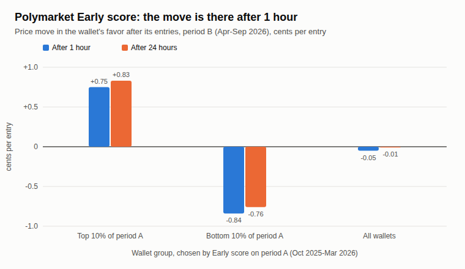
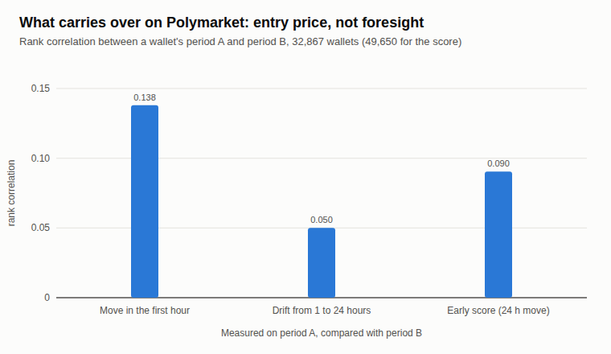
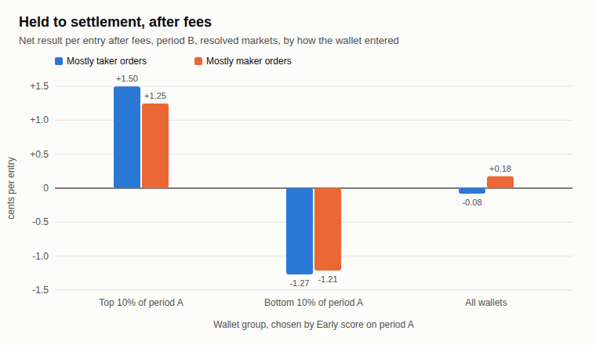

# Polymarket insider score backtest: entry price, not foresight

**Issue 4, October 2026.** Research by the [OrcaLayer](https://orcalayer.com) team using on-chain Polymarket trades.
Write-up: [Polymarket Insider Score: Cheap Entries, Not Foresight](https://orcalayer.com/blog/polymarket-insider-score-entry-price).

We built a wallet score meant to catch traders who get in before the news (the Early score), wrote its rules down before any
run, scored 355,732 wallets on their trades from October 2025 to March 2026 and checked the same wallets from April to
September 2026. The score
passed its own test, but what carried over was the price wallets paid. We never released it. This repository has the aggregated results, the charts and a script that rebuilds the test on the
OrcaLayer API.

## Results

| Question | Result |
|---|---|
| Does the top 10% stay on top six months later? | Yes: +0.83 cents per entry after 24 hours (t 7.9); bottom 10% -0.76 (t -4.7); all wallets -0.01 |
| Is it foresight? | Mostly not: +0.75 of the +0.83 cents was already there after 1 hour. Rank correlation A to B is 0.138 for the first hour and 0.050 for the drift from 1 to 24 hours |
| Held to settlement, after fees? | Top 10% +1.17 cents per entry (t 2.9); bottom 10% -0.96 (t -1.7); all wallets +0.13 (t 0.4) |
| Only makers saving fees? | No: top 10% +1.50 cents on mostly taker entries (t 4.5), +1.25 on mostly maker entries (t 2.4) |
| In dollars? | Top 10% about +$0.17 per $10 after fees (t 2.9); +$0.09 to +$0.15 without the largest events or wallets |

t-statistics use standard errors clustered by event. The mechanism split (rank correlations) and everything held to
settlement were not in the pre-registration: treat them as exploratory.

## Data

All files in `data/` are aggregates over groups of wallets. None of them lists a wallet.

| File | What it holds |
|---|---|
| [`groups_24h_prereg.csv`](data/groups_24h_prereg.csv) | The pre-registered test: groups from period A, their 24-hour move in period B, t, without the 5 largest events, events weighted equally, share of entries with a move of +3 cents or more |
| [`mechanism_1h_vs_24h.csv`](data/mechanism_1h_vs_24h.csv) | 1-hour versus 24-hour move in period B, by group |
| [`rank_corr_components.csv`](data/rank_corr_components.csv) | Rank correlation from A to B for the score, the first-hour move and the drift from 1 to 24 hours (the last two exploratory) |
| [`groups_net.csv`](data/groups_net.csv) | Held to settlement: before fees, fees, after fees, in cents per entry and dollars per $10 (`new_in_B`: wallets with no score in period A) |
| [`groups_net_by_taker.csv`](data/groups_net_by_taker.csv) | The same split by how the entry was filled: mostly taker, mostly maker, or built by selling the opposite outcome |
| [`groups_usd_robust.csv`](data/groups_usd_robust.csv) | Dollars per $10 without the largest events, wallets and entries, and the share held by the largest 1% of entries |
| [`buckets_settlement.csv`](data/buckets_settlement.csv) | Held to settlement by entry price bucket, before fees |
| [`months_net.csv`](data/months_net.csv) | Held to settlement after fees, by month of period B |
| [`k_scan.csv`](data/k_scan.csv) | The test for other values of the shrinkage constant K (pre-registered: 5) |
| [`without_weather.csv`](data/without_weather.csv) | The test without daily weather markets |
| [`score_bands_A.csv`](data/score_bands_A.csv) | How the scores spread on period A |
| [`meta.json`](data/meta.json) | Share of period B entries in closed, resolved markets (85.9%) and definitions |

No wallet scored between 51 and 89 in period A, so the top 10% is every wallet above the neutral band (35,329 wallets,
9.9%) and the bottom group, a score of 10 or less, is 39,131 wallets (11.0%).

Units: "cents per entry" is the mean over entries weighted by size up to $10,000, as in the score. "Dollars per $10" weights
every dollar staked, so large positions count fully. How each number is built is in [METHOD.md](METHOD.md).

## Check it yourself

`scripts/early_score_check.py` runs the same method on the OrcaLayer public API instead of our database. It needs
Python 3.9+ (standard library only) and an OrcaLayer Premium API key.

    export ORCALAYER_API_KEY=...                                   # Premium key: https://orcalayer.com/docs/api
    python3 scripts/early_score_check.py --csv entries.csv        # the first 1,000 markets of data/markets.csv
    python3 scripts/early_score_check.py --load-csv entries.csv   # rerun the analysis, no API calls

**Markets.** `data/markets.csv` lists 2,000 resolved markets (not sports, not short Up or Down markets) whose scheduled
end date was on or after July 1, 2026, ranked by how many entries we found in them in May and June 2026 only.
Nothing from the check period goes into the choice: a list ranked by activity in July to September would already know
which wallets traded there.

**How it differs from the write-up.**
- Shorter periods. The API's trade history starts on May 1, 2026, so the score is built on trades from May and June (A')
  and checked from July to September (B').
- Fewer markets: the first 1,000 of the list by default.
- No trades under $1 in the API. On the same markets the script finds about 5% fewer entries with a 24-hour price than
  our pipeline.
- A different market mix. Markets still open on July 1 are mostly longer "by a date" markets, where the side most
  wallets hold drifts their way as the date nears. On this list every group gains in B', all wallets included, so compare
  the groups with each other and with all wallets, not with zero.

**What we got** (October 21, 2026, the first 1,000 markets). Price move 24 hours after the entry in B', cents per entry,
t in parentheses (standard errors clustered by event):

| | Top 10% of A' | Bottom 10% of A' | All wallets |
|---|---|---|---|
| Public API, this script | +1.25 (4.5) | +0.27 (1.3) | +0.53 (5.4) |
| Our database, same markets | +1.19 (4.5) | +0.25 (1.2) | +0.51 (5.3) |

Our database on a shorter and a longer list: the first 500 markets +1.26 / +0.24 / +0.53, all 2,000 +1.19 / +0.24 / +0.49.

The script also prints the 1-hour move and the result held to settlement. On this list the top 10% led all wallets by
+0.49 cents after 1 hour and by +0.72 after 24 hours, so more than half of the lead came with the entry price and the
rest later; the rank correlation from A' to B' was 0.214 for the first-hour move and 0.042 for the drift after it. Held to
settlement, before fees, the groups did not separate on these markets: top 10% +2.19 cents per entry (t 1.8),
bottom 10% +2.10, all wallets +1.37.

We also served 40 markets to the script from our database in the exact format of the API: the script and our pipeline
found the same 21,209 entries (ours had 4 more, each at exactly $100.00), with equal entry prices, sizes and moves.

**API limits.**
- The first 1,000 markets took 11,658 requests and 1 hour 49 minutes with the default pause (0.15 s); the first 500 about
  9,500 requests.
- A Premium key allows 600 requests per minute and 25,000 per day (reset at 00:00 UTC; keys from subscriptions started
  before October 1, 2026 have no daily cap), so the default run fits in one day.
- The script waits on the per-minute limit by itself. If the daily limit is reached it stops and prints the report for the
  markets read so far; with `--csv` the same command continues where it stopped.
- `--max-pages` (default 400 pages of 500 trades) caps the very largest markets; such a market keeps only the full days
  after the oldest trade fetched.

## What is not here

- **Wallet addresses or rankings.** We describe groups and behavior, not individuals. The script keeps each wallet only as a
  salted hash (the salt is created on first run and saved as `<file>.salt` next to your `--csv` file, so a
  continued run matches the same wallets), so its output is not a list of wallets.
  The trades come from public on-chain data, so the hash does not make wallets secret; it only means this repository does not
  hand out a ranking.
- **Our internal pipeline.** The numbers come from our own indexer and database. The script reproduces the method on the
  OrcaLayer API.

## Earlier issues

- [Polymarket strategies that don't work](https://orcalayer.com/blog/polymarket-strategies-that-dont-work) ([repo](https://github.com/orcalayer/polymarket-arbitrage-market-making-copy-trading-backtests))
- [Copying Polymarket whales](https://orcalayer.com/blog/polymarket-copy-trading-whales-backtest) ([repo](https://github.com/orcalayer/polymarket-copy-trading-whales-backtest))
- [Live football: late goals and stop-losses](https://orcalayer.com/blog/polymarket-live-football-late-goals-stop-loss) ([repo](https://github.com/orcalayer/polymarket-football-late-goal-stop-loss-backtest))

## License

Data, charts and text: [CC BY 4.0](LICENSE). Please credit "OrcaLayer Research" with a link to this repository.

This is research, not financial advice.
